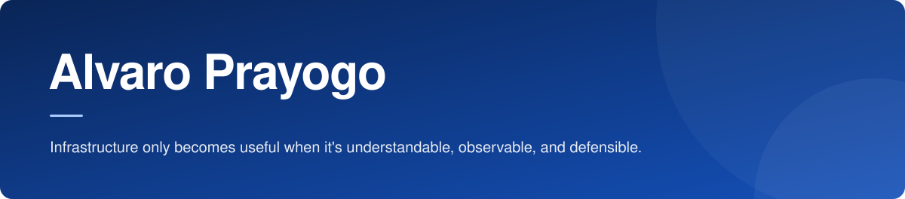
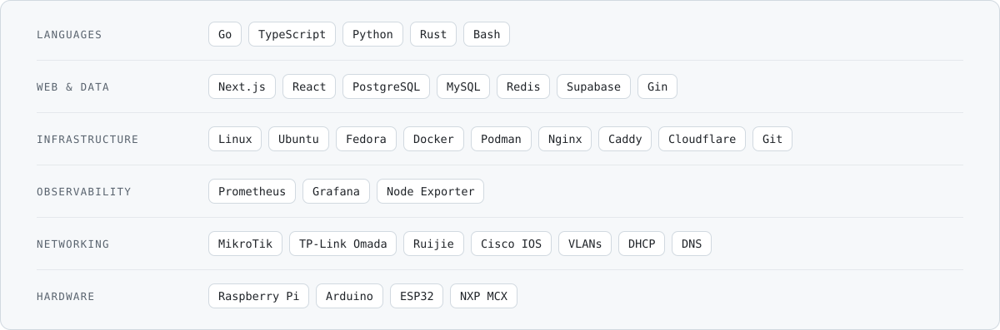

<picture>
  <source media="(max-width: 700px)" srcset="assets/hero-mobile.svg">
  
</picture>

  <a href="https://parothegreat.site">Portfolio</a>
  &nbsp;·&nbsp;
  <a href="https://linkedin.com/in/moehammad-alvaro-pirata-prayogo-842a8834a">LinkedIn</a>
  &nbsp;·&nbsp;
  <a href="mailto:alvaroprayogo38@gmail.com">Email</a>

I started in industrial electronics and moved into Linux infrastructure, networking and security.
I design, deploy and secure what products run on, from the API down to the servers.

### Activity

<picture>
  <source media="(max-width: 700px) and (prefers-color-scheme: dark)" srcset="https://raw.githubusercontent.com/parothegreat/parothegreat/output/activity-mobile-dark.svg">
  <source media="(max-width: 700px)" srcset="https://raw.githubusercontent.com/parothegreat/parothegreat/output/activity-mobile-light.svg">
  <source media="(prefers-color-scheme: dark)" srcset="https://raw.githubusercontent.com/parothegreat/parothegreat/output/activity-dark.svg">
  
</picture>

### Stack

<picture>
  <source media="(max-width: 700px) and (prefers-color-scheme: dark)" srcset="assets/stack-mobile-dark.svg">
  <source media="(max-width: 700px)" srcset="assets/stack-mobile-light.svg">
  <source media="(prefers-color-scheme: dark)" srcset="assets/stack-dark.svg">
  
</picture>
