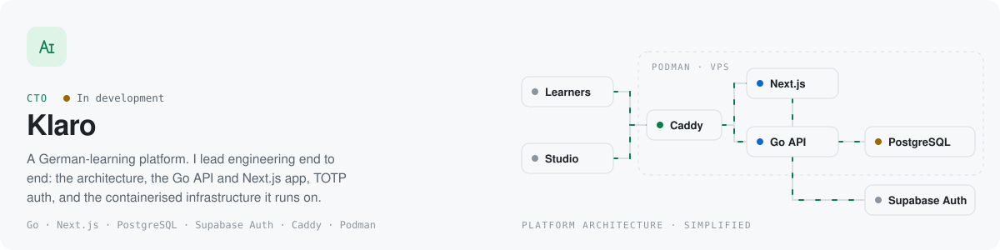
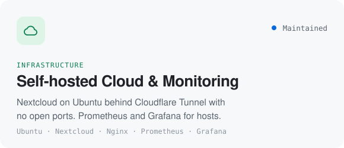
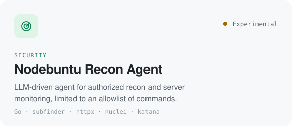
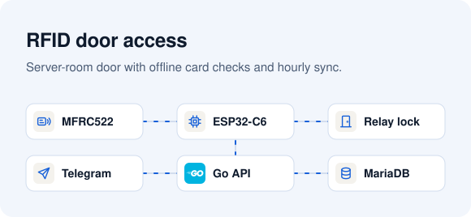
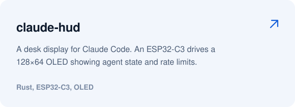
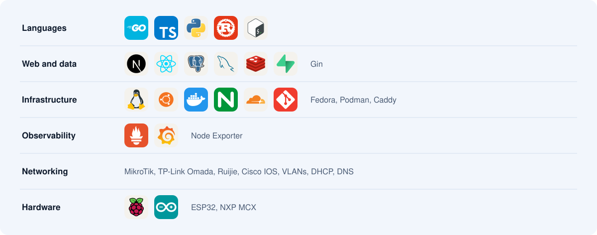

  <a href="https://parothegreat.site">Portfolio</a>
  &nbsp;·&nbsp;
  <a href="https://linkedin.com/in/moehammad-alvaro-pirata-prayogo-842a8834a">LinkedIn</a>
  &nbsp;·&nbsp;
  <a href="mailto:alvaroprayogo38@gmail.com">Email</a>

I started in industrial electronics, moved into Linux infrastructure, networking and security, and now lead
engineering as CTO of Klaro. I design, deploy and secure what the product runs on, from the API down to the servers.

### Now

<picture>
  <source media="(prefers-color-scheme: dark)" srcset="assets/klaro-dark.svg">
  
</picture>

### Built along the way

  <picture><source media="(prefers-color-scheme: dark)" srcset="assets/card-cloud-dark.svg"></picture>
  <a href="https://github.com/parothegreat/go-bot"><picture><source media="(prefers-color-scheme: dark)" srcset="assets/card-recon-dark.svg"></picture></a>

  <picture><source media="(prefers-color-scheme: dark)" srcset="assets/card-rfid-dark.svg"></picture>
  <a href="https://github.com/parothegreat/claude-hud"><picture><source media="(prefers-color-scheme: dark)" srcset="assets/card-claude-hud-dark.svg"></picture></a>

### Stack

<picture>
  <source media="(prefers-color-scheme: dark)" srcset="assets/stack-dark.svg">
  
</picture>
