<a href="https://parothegreat.site">
  <picture>
    <source media="(prefers-color-scheme: dark)" srcset="assets/banner-dark.svg">
    
  </picture>
</a>

  <a href="https://parothegreat.site"><b>parothegreat.site</b></a>
  &nbsp;·&nbsp;
  <a href="https://linkedin.com/in/moehammad-alvaro-pirata-prayogo-842a8834a">LinkedIn</a>
  &nbsp;·&nbsp;
  <a href="mailto:alvaroprayogo38@gmail.com">alvaroprayogo38@gmail.com</a>

 

I'm a DevOps engineer based in Cikarang, Indonesia, trained in **industrial electronic engineering**.
I started with circuit boards and microcontrollers and worked my way up the stack to Linux servers,
containers and networks, the layer that keeps services running and observable.

Most of my work is configuring Linux hosts and Nginx, packaging services with Docker, wiring networks
(DNS, VLANs, MikroTik), and watching it all through Prometheus and Grafana. When a job needs a tool I write
it in Go, Python or TypeScript. When it needs a device, I still reach for an ESP32.

## Selected work

<table>
  <tr>
    <td width="50%" valign="top">
      <a href="https://github.com/parothegreat/claude-hud"><b>claude-hud</b></a> 
      <code>Rust</code> <code>ESP32-C3</code> <code>OLED</code>
      
A desk display for Claude Code. An ESP32-C3 drives a 128×64 OLED that shows what the agent is doing, how much of the 5-hour and 7-day limits are used, and when they reset.

    </td>
    <td width="50%" valign="top">
      <a href="https://github.com/parothegreat/go-bot"><b>Nodebuntu Recon Agent</b></a> 
      <code>Go</code> <code>LLM agents</code> <code>Linux</code>
      
An autonomous agent on an Ubuntu server. It reasons with an LLM, orchestrates recon tooling, reports CPU, RAM, disk and service health, and only runs commands from an allowlist.

    </td>
  </tr>
  <tr>
    <td width="50%" valign="top">
      <a href="https://github.com/parothegreat/realtime-hand-fx"><b>realtime-hand-fx</b></a> 
      <code>Python</code> <code>MediaPipe</code> <code>Computer vision</code>
      
Real-time visual effects driven by webcam hand tracking, in the style of TouchDesigner installations but written from scratch in Python.

    </td>
    <td width="50%" valign="top">
      <a href="https://github.com/parothegreat/go_http_checker"><b>go_http_checker</b></a> 
      <code>Go</code> <code>Concurrency</code> <code>CLI</code>
      
Checks many URLs in parallel with goroutines and channels, sorts results into 2xx, 4xx, 5xx and network errors, and enforces a per-request timeout.

    </td>
  </tr>
</table>

## Toolbox

<table>
  <tr>
    <td><b>Systems</b></td>
    <td></td>
    <td>Linux, systemd, Nginx, Docker</td>
  </tr>
  <tr>
    <td><b>Networking</b></td>
    <td></td>
    <td>TCP/IP, DNS, VLAN, MikroTik</td>
  </tr>
  <tr>
    <td><b>Languages</b></td>
    <td></td>
    <td>REST services, CLIs, firmware</td>
  </tr>
  <tr>
    <td><b>Data</b></td>
    <td></td>
    <td>MariaDB, PostgreSQL, Redis</td>
  </tr>
  <tr>
    <td><b>Observability</b></td>
    <td></td>
    <td>Metrics, dashboards, HTTP checks</td>
  </tr>
</table>

 

Open to conversations about DevOps, infrastructure and embedded projects. Email is the fastest way to reach me.

