<a href="https://parothegreat.site">
  <picture>
    <source media="(prefers-color-scheme: dark)" srcset="assets/hero-dark.svg">
    
  </picture>
</a>

  <a href="https://parothegreat.site">Portfolio</a>
  &nbsp;·&nbsp;
  <a href="https://linkedin.com/in/moehammad-alvaro-pirata-prayogo-842a8834a">LinkedIn</a>
  &nbsp;·&nbsp;
  <a href="mailto:alvaroprayogo38@gmail.com">Email</a>

### Now

<a href="https://klarogerman.de">
  <picture>
    <source media="(prefers-color-scheme: dark)" srcset="assets/klaro-dark.svg">
    
  </picture>
</a>

### Built along the way

  <a href="https://parothegreat.site"><picture><source media="(prefers-color-scheme: dark)" srcset="assets/card-cloud-dark.svg"></picture></a>
  <a href="https://github.com/parothegreat/go-bot"><picture><source media="(prefers-color-scheme: dark)" srcset="assets/card-recon-dark.svg"></picture></a>

  <a href="https://parothegreat.site"><picture><source media="(prefers-color-scheme: dark)" srcset="assets/card-rfid-dark.svg"></picture></a>
  <a href="https://github.com/parothegreat/claude-hud"><picture><source media="(prefers-color-scheme: dark)" srcset="assets/card-claude-hud-dark.svg"></picture></a>

### Stack

<picture>
  <source media="(prefers-color-scheme: dark)" srcset="https://skillicons.dev/icons?i=go,ts,nextjs,postgres,python,rust,linux,docker,nginx,cloudflare,prometheus,grafana&theme=dark">
  
</picture>

  

Bekasi, Indonesia · GMT+7

